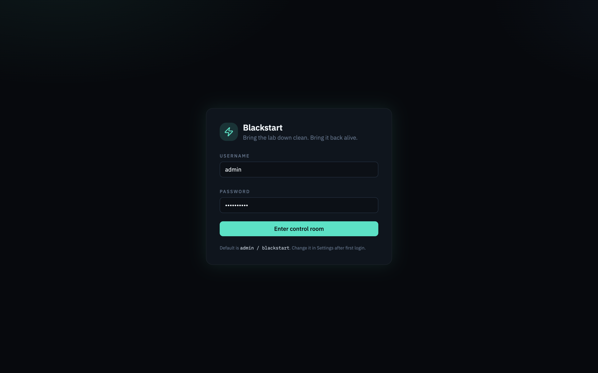
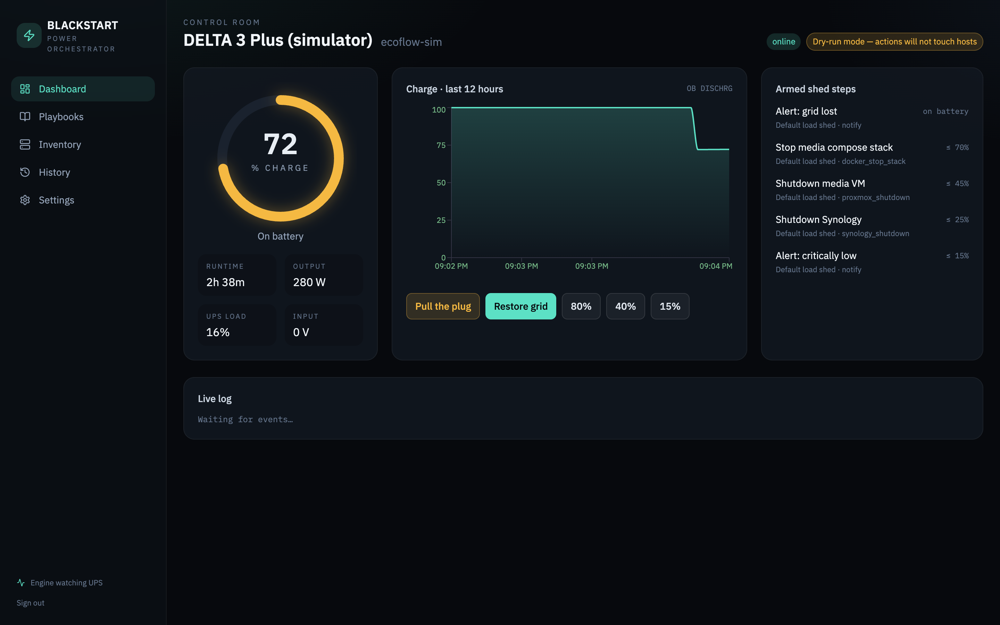
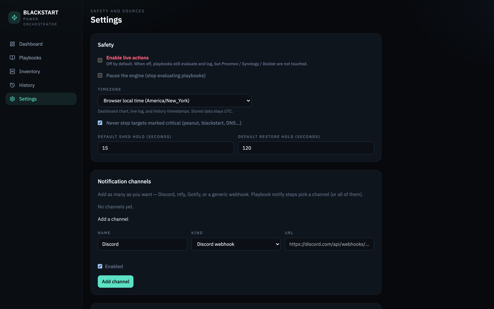
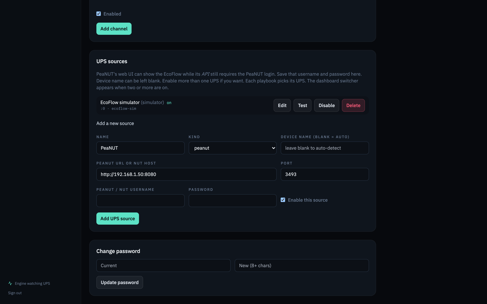

<p align="center">
  
</p>

<p align="center">
  <strong>Bring the lab down clean. Bring it back alive.</strong><br>
  A control-room UI that watches your UPS and orchestrates Proxmox, Synology, Docker, k3s, and more when the grid dies.
</p>

<p align="center">
  
</p>

Blackstart is the playbook engine. [PeaNUT](https://github.com/Brandawg93/PeaNUT) / [NUT](https://networkupstools.org/) is the UPS collector. They sit next to each other — Blackstart never claims the UPS USB port.

```
UPS  --USB-->  NUT (upsd)  -->  PeaNUT :8080   (dashboard)
                           \-->  Blackstart :8088  (shed / restore)
                                      |
                                      +--> Proxmox VE / PBS / Synology / Docker / k3s / OMV / SSH / WOL
```

**Live actions are off by default.** Dry-run and the built-in EcoFlow-class simulator first. MIT licensed. Created with [Grok Build](https://grok.com).

---

## Screenshots

### Login

There is no default password. On first start Blackstart uses `BLACKSTART_ADMIN_PASSWORD` if you set a strong one, otherwise it writes a random one to `<data dir>/initial-admin-password.txt` (`/data` in Docker, `/var/lib/blackstart` on the LXC). You must pick a new password at first login; the file is deleted after that.



### Dashboard

Battery ring, 12-hour charge chart, armed shed/restore steps, simulator controls.


Grid lost (simulator **Pull the plug**). Ring goes amber; shed ladder is armed.



### Playbooks

Each playbook is linked to one UPS; you can have several shed playbooks on the same UPS (they all run). Hold seconds so a 2-second flicker does not fire a step. A playbook linked to nothing, a deleted UPS, or the simulator while a real UPS exists shows a warning.


### Inventory

Hosts (the machines Blackstart logs into) and targets (VM 204, a compose stack, the NAS). Discover imports guests from Proxmox, containers from Docker, nodes from k3s.


### Settings

Safety switches, Discord/ntfy/Gotify, and UPS sources. Point a **peanut** source at `http://<peanut-ip>:8080`.





### History

Every dry run, live run, and outage episode. Clear history is behind a confirm dialog.


---

## Install

Pick one place that **stays up during a shed** (same UPS as PeaNUT). Mark it critical. Never list it in a load-shed playbook.

| Path | Guide |
| --- | --- |
| **Proxmox LXC** | [deploy/lxc.md](deploy/lxc.md) — Debian 12 CT, Python only, UI already built |
| **Docker Compose / Portainer** | [deploy/docker.md](deploy/docker.md) — pull `ghcr.io/moviemakr1620/blackstart:latest` |
| **docker run** | [deploy/docker.md](deploy/docker.md#docker-run) |
| **PeaNUT / NUT** | [deploy/peanut.md](deploy/peanut.md) — USB UPS, helper-script LXC, or Docker |

### Proxmox LXC (short)

On the Proxmox host: **Create CT** — Debian 12, 2 cores, 1 GB RAM, 8 GB disk, unprivileged, start at boot, **no USB**. Then inside the CT:

```bash
apt update && apt install -y git ca-certificates
git clone https://github.com/moviemakr1620/blackstart.git /opt/blackstart
cd /opt/blackstart
bash deploy/install-lxc.sh
```

Open `http://<lxc-ip>:8088`. Full walkthrough (UI create, `create-lxc.sh`, updates): **[deploy/lxc.md](deploy/lxc.md)**.

### Docker Compose / Portainer (short)

Paste the stack in [deploy/docker.md](deploy/docker.md#portainer--dockhand-pull-the-image) into Portainer or Dockhand, replace the `REPLACE_ME_…` placeholders, and deploy. No clone or build on the NAS.

From this repo with Compose:

```bash
git clone https://github.com/moviemakr1620/blackstart.git
cd blackstart
cp .env.example .env          # set BLACKSTART_SECRET_KEY and BLACKSTART_ADMIN_PASSWORD
docker compose pull
docker compose up -d
# http://<host>:8088
```

Compose will refuse to start if the secret key or admin password is missing.

Need Wake-on-LAN from the container? Use `network_mode: host` on Linux — see [deploy/docker.md](deploy/docker.md).

### docker run (short)

```bash
docker run -d --name blackstart --restart unless-stopped \
  -p 8088:8088 \
  -e BLACKSTART_SECRET_KEY="$(openssl rand -hex 32)" \
  -e BLACKSTART_ADMIN_PASSWORD='pick-a-strong-password' \
  -v blackstart-data:/data \
  ghcr.io/moviemakr1620/blackstart:latest
```

---

## Connect PeaNUT

1. Install PeaNUT/NUT with USB on **its** LXC or container — not on Blackstart. Guide: **[deploy/peanut.md](deploy/peanut.md)**.
2. Blackstart → **Settings → UPS sources** → kind `peanut`, URL `http://<peanut-ip>:8080`. Add the PeaNUT login if auth is on.
3. **Test**. Disable the simulator once the ring looks right.

```
# Proxmox host — PeaNUT helper LXC (includes a current NUT)
bash -c "$(curl -fsSL https://raw.githubusercontent.com/community-scripts/ProxmoxVE/main/ct/peanut.sh)"
```

Then pass the UPS USB into **that** CT only.

---

## First hour in the UI

1. Log in with the first-run password and set your own.
2. Leave **Enable live actions** off.
3. Dashboard → **Pull the plug** on the simulator. Watch History.
4. **Inventory → Add host** — Proxmox token (`user@pam!name`, uncheck privilege separation or ACL the **token** on `/`), Synology, Docker, k3s, PBS (`pbs`, port 8007), OMV, SSH.
5. **Discover**. Mark PeaNUT, Blackstart, DNS, and the firewall **critical**.
6. Edit the seed playbooks (shed + restore). Dry run.
7. Point the playbook at your real UPS. Enable live actions only when you are ready.

A typical shed ladder:

1. Grid lost → notify  
2. ≤ 70% → stop a compose stack  
3. ≤ 45% → ACPI-shutdown media VMs  
4. ≤ 25% → shut down the NAS  
5. ≤ 15% → last notify (leave Blackstart + PeaNUT up)

Restore: WOL the NAS → wait until DSM `:5001` answers → `restore_auto` (starts only what this outage stopped).

### Do I need a restore playbook?

No. A `restore_auto` step can sit at the end of a shed playbook behind a "grid is back" (and, say, battery ≥ 80%) trigger. A separate restore playbook is only useful when bringing things back takes its own ordered steps first (WOL the NAS, wait for it, then start what depends on it).

**What `restore_auto` undoes:** every time a step stops something, Blackstart records it against the current outage *for that UPS*. `restore_auto` starts everything recorded for that UPS's outage, newest first, no matter which shed playbook stopped it. Things that were already off before the outage are never recorded, so they stay off. Each item is restored once; a dry run leaves them pending.

### When steps fire

- "Grid lost" / battery-level steps fire **once per outage**. If the power flickers back and then fails again, they re-arm.
- "Grid is back" steps (and everything in a restore playbook) only run while an outage is open. Starting Blackstart on a healthy grid does not fire them.
- If Blackstart restarts mid-outage it picks up the same outage and does not repeat steps that already ran.
- An outage is closed 12 hours after the grid returns.

Proxmox token notes: [deploy/proxmox-token.md](deploy/proxmox-token.md).

---

## Safety model

- Live actions default **off**. With live actions off, power actions (stop/shutdown/start) are logged as dry runs, but **notify, webhook and wait steps still run for real** during an automatic outage so you are told about it. A manual **Dry run** of a playbook sends nothing.
- Engine can be paused
- Critical targets cannot be stopped
- Thresholds must **hold** for N seconds
- Each step fires **once per outage episode**
- `restore_auto` reverses only what Blackstart stopped (newest first)
- Every action is in History
- If the UPS stops reporting for `ups_stale_alert_sec` (default 60 s) Blackstart notifies you once and pauses hold timers until it reports again
- Optional heartbeat URL (Settings), pinged every minute, for a dead-man alert (Healthchecks.io, Uptime Kuma push)
- HTTPS certificates are verified for new hosts. For a self-signed Proxmox/PBS/DSM certificate paste it (or your CA) into the host's **Trusted certificate** box instead of turning verification off
- SSH host keys are pinned on first **Test** (trust on first use). If a host is rebuilt, press **forget** on the host card and test again
- Stored credentials are encrypted with a key derived from the secret key; API responses never return them (notification URLs show only a hint)
- The secret key comes from `BLACKSTART_SECRET_KEY`, or is generated once into `<data dir>/secret.key`. Placeholders such as `change-me` are refused. Back up the data dir: without the key, stored credentials cannot be read
- Login is rate-limited; changing the password signs out every other session
- Proxmox shutdowns send `forceStop` after the step's timeout; keep the step timeout longer than the guest needs to shut down cleanly

Do not give the Proxmox token `Sys.PowerMgmt` unless a playbook will shut the node. Do not shed the CT that runs NUT or Blackstart.

---

## Hosts Blackstart can drive

| Kind | Port | Discover |
| --- | --- | --- |
| **proxmox** (VE) | 8006 | VMs + LXCs on every node |
| **pbs** (Backup Server) | 8007 | The PBS node (halt + WOL) |
| **synology** | 5001 | NAS + Container Manager; HA uses both MACs |
| **docker** | 22 / 2375 | Containers + compose stacks |
| **k3s** | 22 | All nodes from one control plane |
| **omv** | 443 | Halt / reboot, Docker if SSH can |
| **ssh** | 22 | Custom commands |

---

## Updates

**LXC**

```bash
cd /opt/blackstart && git pull && bash deploy/install-lxc.sh
```

Re-running the installer updates Python dependencies and the systemd unit, then restarts the service. The LXC serves `backend/static/`, which is committed already built, so `git pull` updates the UI too.

**Docker**

```bash
docker compose pull && docker compose up -d
```

---

## Dev (two terminals)

```bash
# API
cd backend
python3 -m venv .venv && source .venv/bin/activate
pip install -r requirements-dev.txt
export BLACKSTART_DATA_DIR=./data   # secret.key and the DB go here
PYTHONPATH=. uvicorn app.main:app --reload --port 8088

# UI
cd frontend
npm install
npm run dev
# http://127.0.0.1:5173
```

`make test` runs the backend suite. `make ui` rebuilds the static files the LXC serves.

---

## API

`POST /api/auth/login` then `Authorization: Bearer <jwt>`. Useful routes: `/api/ups/status`, `/api/policies`, `/api/hosts/{id}/discover`, `/api/policies/{id}/run`, `/api/ws` (send `{"token": "<jwt>"}` as the first message). Schema: `/docs`. The API does not allow cross-origin browser calls.

---

## License

[MIT](LICENSE).

Created with [Grok Build](https://grok.com).

Stack: FastAPI + SQLite · React/Vite/Tailwind · PeaNUT HTTP / NUT TCP · Proxmox · DSM · Docker · k3s · SSH · WOL · Discord / ntfy / Gotify.
