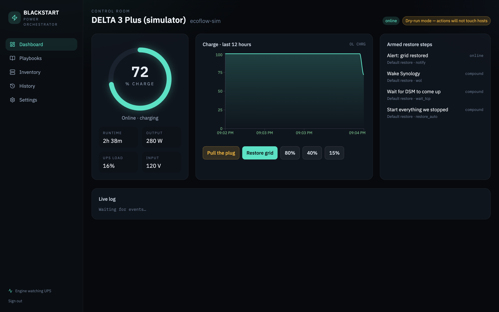
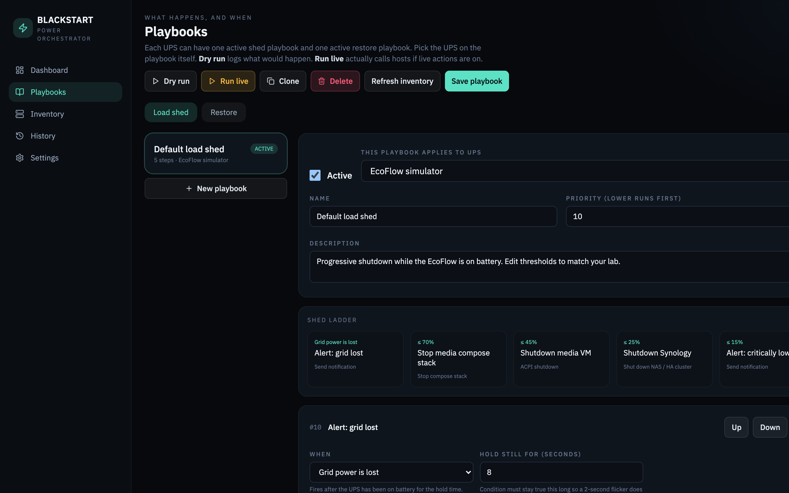
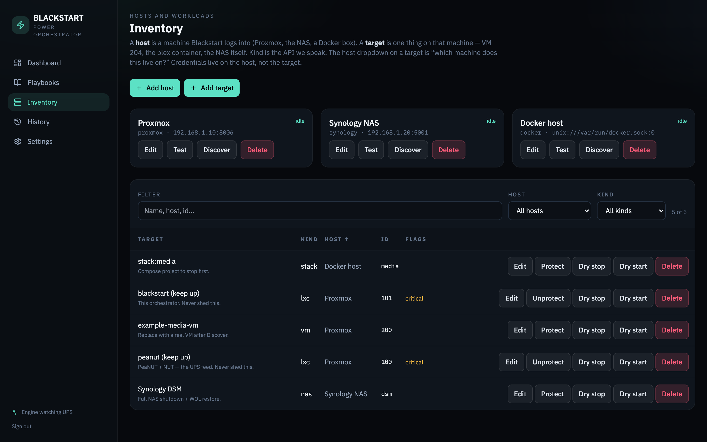
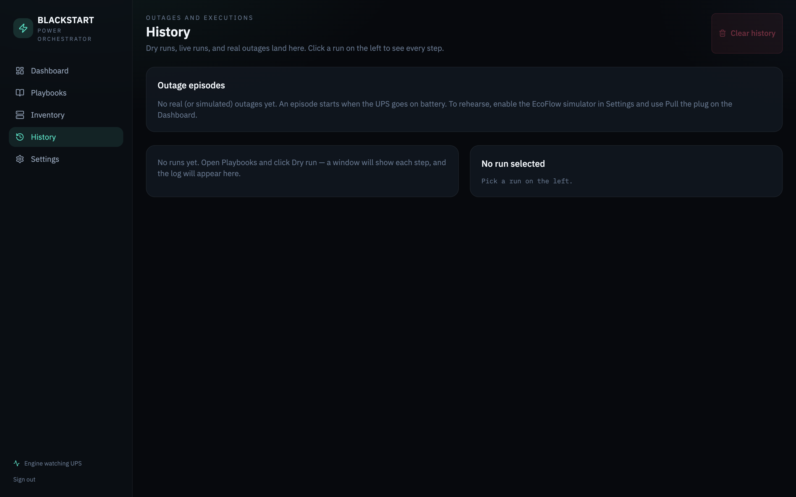

<p align="center">
  
</p>

<p align="center">
  <strong>Bring the lab down clean. Bring it back alive.</strong><br>
  A control-room UI that watches your UPS and orchestrates Proxmox, Synology, Docker, k3s, and more when the grid dies.
</p>

<p align="center">
  
</p>

Blackstart is the playbook engine. [PeaNUT](https://github.com/Brandawg93/PeaNUT) / [NUT](https://networkupstools.org/) is the UPS collector. They sit next to each other — Blackstart never claims the UPS USB port.

```
UPS  --USB-->  NUT (upsd)  -->  PeaNUT :8080   (dashboard)
                           \-->  Blackstart :8088  (shed / restore)
                                      |
                                      +--> Proxmox VE / PBS / Synology / Docker / k3s / OMV / SSH / WOL
```

**Live actions are off by default.** Dry-run and the built-in EcoFlow-class simulator first. MIT licensed. Created with [Grok Build](https://grok.com).

---

## Screenshots

### Login

Default is `admin` / `blackstart`. Change it in Settings immediately.


### Dashboard

Battery ring, 12-hour charge chart, armed shed/restore steps, simulator controls.



Grid lost (simulator **Pull the plug**). Ring goes amber; shed ladder is armed.


### Playbooks

One active **load-shed** playbook and one **restore** playbook per UPS. Hold seconds so a 2-second flicker does not fire a step.



### Inventory

Hosts (the machines Blackstart logs into) and targets (VM 204, a compose stack, the NAS). Discover imports guests from Proxmox, containers from Docker, nodes from k3s.



### Settings

Safety switches, Discord/ntfy/Gotify, and UPS sources. Point a **peanut** source at `http://<peanut-ip>:8080`.


### History

Every dry run, live run, and outage episode. Clear history is behind a confirm dialog.



---

## Install

Pick one place that **stays up during a shed** (same UPS as PeaNUT). Mark it critical. Never list it in a load-shed playbook.

| Path | Guide |
| --- | --- |
| **Proxmox LXC** | [deploy/lxc.md](deploy/lxc.md) — Debian 12 CT, Python only, UI already built |
| **Docker Compose** | [deploy/docker.md](deploy/docker.md) — `docker compose up -d --build` |
| **docker run** | [deploy/docker.md](deploy/docker.md#docker-run) |
| **PeaNUT / NUT** | [deploy/peanut.md](deploy/peanut.md) — USB UPS, helper-script LXC, or Docker |

### Proxmox LXC (short)

On the Proxmox host: **Create CT** — Debian 12, 2 cores, 1 GB RAM, 8 GB disk, unprivileged, start at boot, **no USB**. Then inside the CT:

```bash
apt update && apt install -y git ca-certificates
git clone https://github.com/moviemakr1620/blackstart.git /opt/blackstart
cd /opt/blackstart
bash deploy/install-lxc.sh
```

Open `http://<lxc-ip>:8088`. Full walkthrough (UI create, `create-lxc.sh`, updates): **[deploy/lxc.md](deploy/lxc.md)**.

### Docker Compose (short)

```bash
git clone https://github.com/moviemakr1620/blackstart.git
cd blackstart
cp .env.example .env          # set BLACKSTART_SECRET_KEY
docker compose up -d --build
# http://<host>:8088
```

Need Wake-on-LAN from the container? Use `network_mode: host` on Linux — see [deploy/docker.md](deploy/docker.md).

### docker run (short)

```bash
git clone https://github.com/moviemakr1620/blackstart.git
cd blackstart
docker build -t blackstart .
docker run -d --name blackstart --restart unless-stopped \
  -p 8088:8088 \
  -e BLACKSTART_SECRET_KEY="$(openssl rand -hex 32)" \
  -v blackstart-data:/data \
  blackstart
```

---

## Connect PeaNUT

1. Install PeaNUT/NUT with USB on **its** LXC or container — not on Blackstart. Guide: **[deploy/peanut.md](deploy/peanut.md)**.
2. Blackstart → **Settings → UPS sources** → kind `peanut`, URL `http://<peanut-ip>:8080`. Add the PeaNUT login if auth is on.
3. **Test**. Disable the simulator once the ring looks right.

```
# Proxmox host — PeaNUT helper LXC (includes a current NUT)
bash -c "$(curl -fsSL https://raw.githubusercontent.com/community-scripts/ProxmoxVE/main/ct/peanut.sh)"
```

Then pass the UPS USB into **that** CT only.

---

## First hour in the UI

1. Change the admin password.
2. Leave **Enable live actions** off.
3. Dashboard → **Pull the plug** on the simulator. Watch History.
4. **Inventory → Add host** — Proxmox token (`user@pam!name`, uncheck privilege separation or ACL the **token** on `/`), Synology, Docker, k3s, PBS (`pbs`, port 8007), OMV, SSH.
5. **Discover**. Mark PeaNUT, Blackstart, DNS, and the firewall **critical**.
6. Edit the seed playbooks (shed + restore). Dry run.
7. Point the playbook at your real UPS. Enable live actions only when you are ready.

A typical shed ladder:

1. Grid lost → notify  
2. ≤ 70% → stop a compose stack  
3. ≤ 45% → ACPI-shutdown media VMs  
4. ≤ 25% → shut down the NAS  
5. ≤ 15% → last notify (leave Blackstart + PeaNUT up)

Restore: WOL the NAS → wait until DSM `:5001` answers → `restore_auto` (starts only what this outage stopped).

Proxmox token notes: [deploy/proxmox-token.md](deploy/proxmox-token.md).

---

## Safety model

- Live actions default **off**
- Engine can be paused
- Critical targets cannot be stopped
- Thresholds must **hold** for N seconds
- Each step fires **once per outage episode**
- `restore_auto` reverses only what Blackstart stopped (newest first)
- Every action is in History

Do not give the Proxmox token `Sys.PowerMgmt` unless a playbook will shut the node. Do not shed the CT that runs NUT or Blackstart.

---

## Hosts Blackstart can drive

| Kind | Port | Discover |
| --- | --- | --- |
| **proxmox** (VE) | 8006 | VMs + LXCs on every node |
| **pbs** (Backup Server) | 8007 | The PBS node (halt + WOL) |
| **synology** | 5001 | NAS + Container Manager; HA uses both MACs |
| **docker** | 22 / 2375 | Containers + compose stacks |
| **k3s** | 22 | All nodes from one control plane |
| **omv** | 443 | Halt / reboot, Docker if SSH can |
| **ssh** | 22 | Custom commands |

---

## Updates

**LXC**

```bash
cd /opt/blackstart && git pull && systemctl restart blackstart
```

The LXC serves `backend/static/` (already built). After a source-only commit you would need `make ui`; releases that change the UI include that bundle.

**Docker**

```bash
cd blackstart && git pull && docker compose up -d --build
```

---

## Dev (two terminals)

```bash
# API
cd backend
python3 -m venv .venv && source .venv/bin/activate
pip install -r requirements.txt
PYTHONPATH=. uvicorn app.main:app --reload --port 8088

# UI
cd frontend
npm install
npm run dev
# http://127.0.0.1:5173
```

`make test` runs the backend suite. `make ui` rebuilds the static files the LXC serves.

---

## API

`POST /api/auth/login` then `Authorization: Bearer <jwt>`. Useful routes: `/api/ups/status`, `/api/policies`, `/api/hosts/{id}/discover`, `/api/policies/{id}/run`, `/api/ws`. Schema: `/docs`.

---

## License

[MIT](LICENSE). Default login is `admin` / `blackstart` — change it.

Created with [Grok Build](https://grok.com).

Stack: FastAPI + SQLite · React/Vite/Tailwind · PeaNUT HTTP / NUT TCP · Proxmox · DSM · Docker · k3s · SSH · WOL · Discord / ntfy / Gotify.
