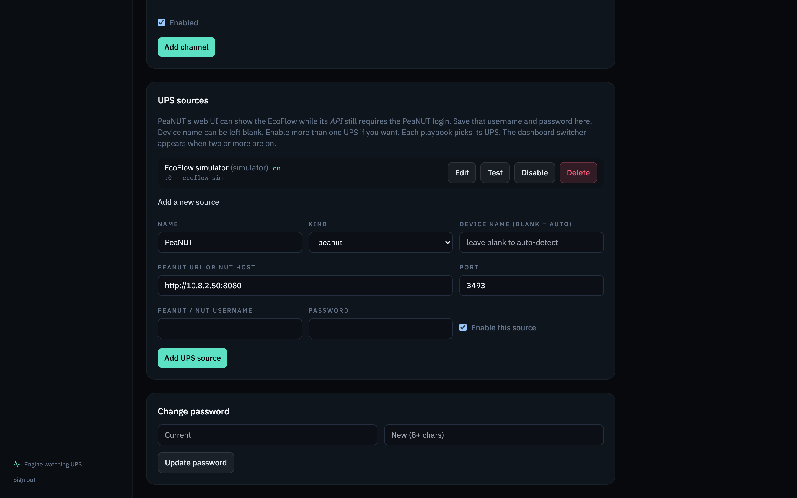

# Install PeaNUT and connect it to Blackstart

Blackstart does **not** talk to the UPS USB port. [PeaNUT](https://github.com/Brandawg93/PeaNUT) (and the NUT server behind it) owns the cable. Blackstart polls PeaNUT over HTTP, or NUT on TCP `3493`.

```
UPS USB  -->  NUT (upsd)  -->  PeaNUT :8080
                         \-->  Blackstart :8088  (HTTP client)
```

Keep PeaNUT on the same UPS as Blackstart. Mark both **critical**. Never shed them.

## 1. Proxmox LXC (recommended for a USB UPS)

The [Proxmox VE Helper Scripts](https://community-scripts.org/scripts?id=peanut) installer builds PeaNUT **and** a current NUT. That matters for EcoFlow and other HID devices that stock Debian NUT 2.8.0 cannot drive.

On the **Proxmox host** shell:

```bash
bash -c "$(curl -fsSL https://raw.githubusercontent.com/community-scripts/ProxmoxVE/main/ct/peanut.sh)"
```

Then pass the UPS USB into that CT:

1. On the Proxmox host: `lsusb` — note bus/device (example `001/005`).
2. CT → **Resources → Add → Device Passthrough** → `/dev/bus/usb/001/005` (or bind the whole bus).
3. Privileged CT is the least painful path for USB HID. Unprivileged USB is possible but fiddly.
4. Inside the PeaNUT CT, confirm NUT sees the pack:

```bash
upsc -l
upsc ecoflow          # or whatever name NUT assigned
```

You want `ups.status: OL` (or `OL CHRG`) and a charge percent. Open PeaNUT at `http://<peanut-ip>:8080`.

**EcoFlow Delta 3 Plus:** use the **UPS USB** port, not the charge USB. You need NUT **≥ 2.8.3** (the helper-script LXC already has this). If `upsc` has no watts, the HID is connected but the CDC ACM channel may not be; that is a NUT/PeaNUT issue, not Blackstart.

Do **not** also pass that USB into the Blackstart CT. One collector only.

## 2. Docker (NUT already on the LAN)

If `upsd` already listens on your network:

```bash
mkdir -p peanut-config
docker run -d --name peanut --restart unless-stopped \
  -p 8080:8080 \
  -v "$PWD/peanut-config:/config" \
  -e WEB_PORT=8080 \
  -e NUT_HOST=192.168.1.50 \
  -e NUT_PORT=3493 \
  brandawg93/peanut:latest
```

Compose:

```yaml
services:
  peanut:
    image: brandawg93/peanut:latest
    container_name: peanut
    restart: unless-stopped
    ports:
      - "8080:8080"
    volumes:
      - ./peanut-config:/config
    environment:
      WEB_PORT: "8080"
      NUT_HOST: 192.168.1.50
      NUT_PORT: "3493"
```

PeaNUT v6 enables login by default. Create the account on first visit. Put that username/password into Blackstart.

`upsd` must listen on the LAN, not only localhost:

```
# /etc/nut/upsd.conf
LISTEN 0.0.0.0 3493
```

## 3. Point Blackstart at PeaNUT

In **Settings → UPS sources**:

| Field | Value |
| --- | --- |
| Kind | `peanut` |
| PeaNUT URL | `http://<peanut-ip>:8080` |
| Device name | blank (auto) or the name from PeaNUT / `upsc -l` |
| Username / password | PeaNUT login if auth is on |

Click **Test**. You should see model, `OL`/`OB`, and charge. Then **Add UPS source** (or save changes) and disable the built-in simulator.

You can also add a **NUT** source (`host:3493`) if you would rather skip PeaNUT’s HTTP API. PeaNUT is still useful as a human dashboard.



## 4. Sanity checks

| Check | Command / UI |
| --- | --- |
| NUT has a device | `upsc -l` on the NUT host |
| Charge is real | `upsc <name> battery.charge` |
| PeaNUT UI | `http://<peanut-ip>:8080` |
| Blackstart | Settings → Test, then Dashboard ring |

If Test fails with 401, PeaNUT wants a login — save it on the UPS source. If it fails with connection refused, you have the wrong IP/port or `upsd` is localhost-only.
